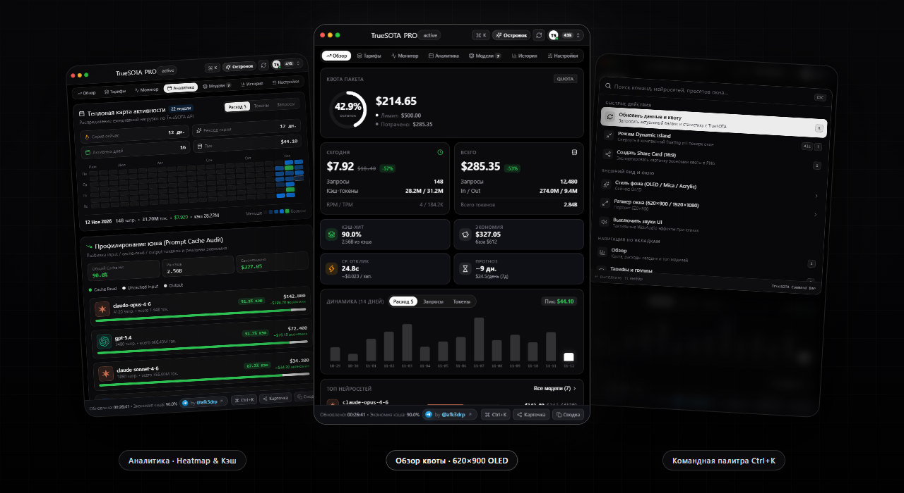
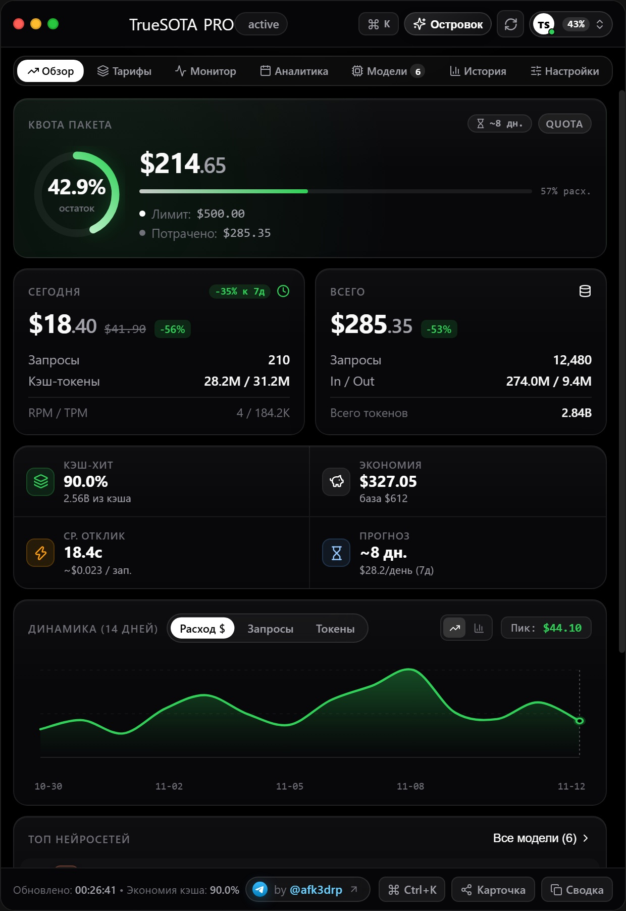
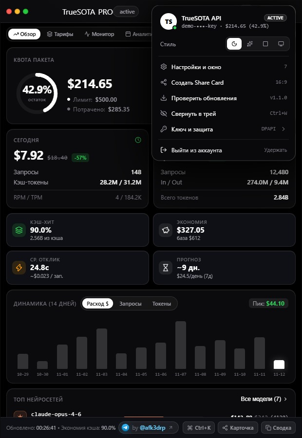
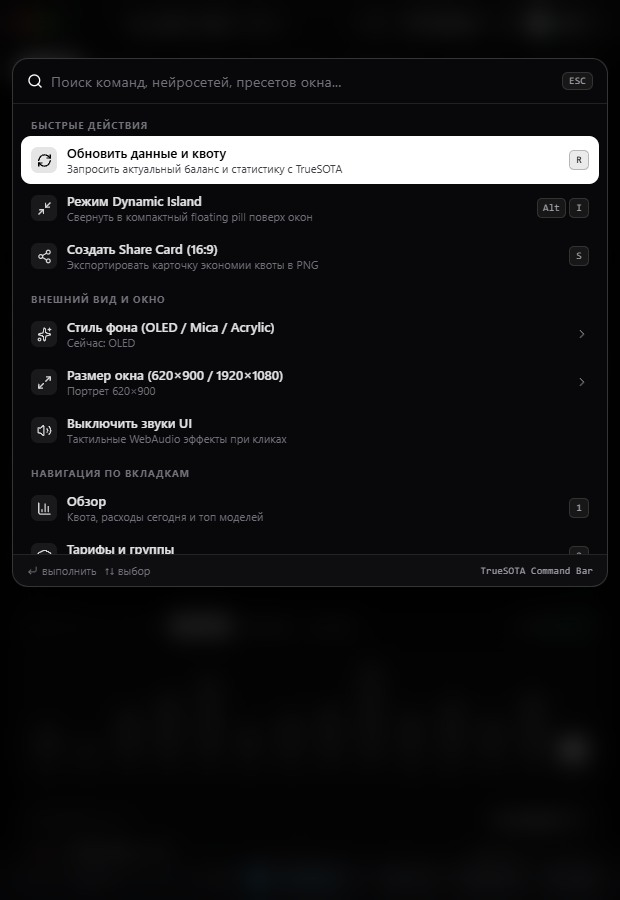
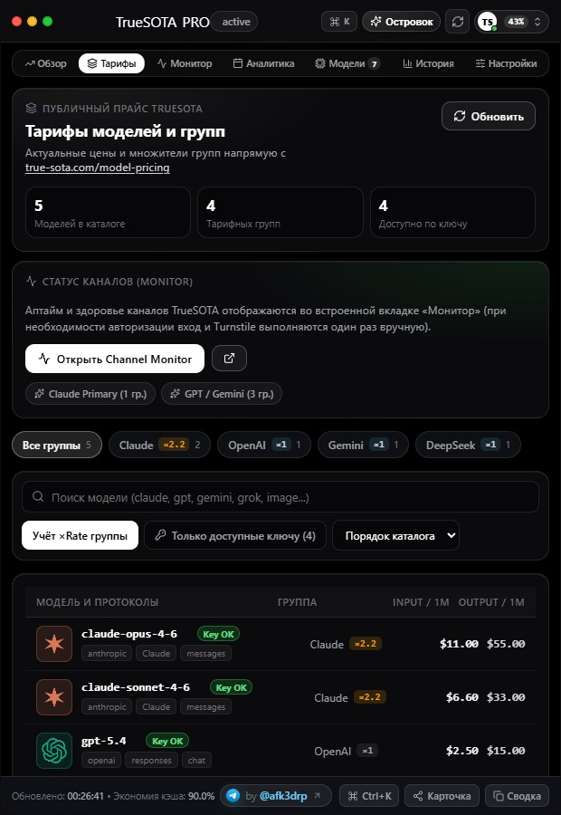
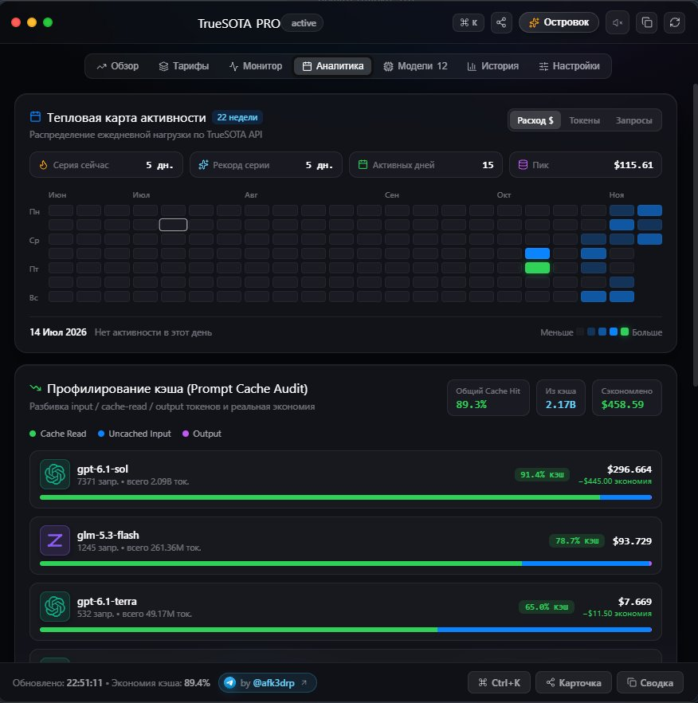
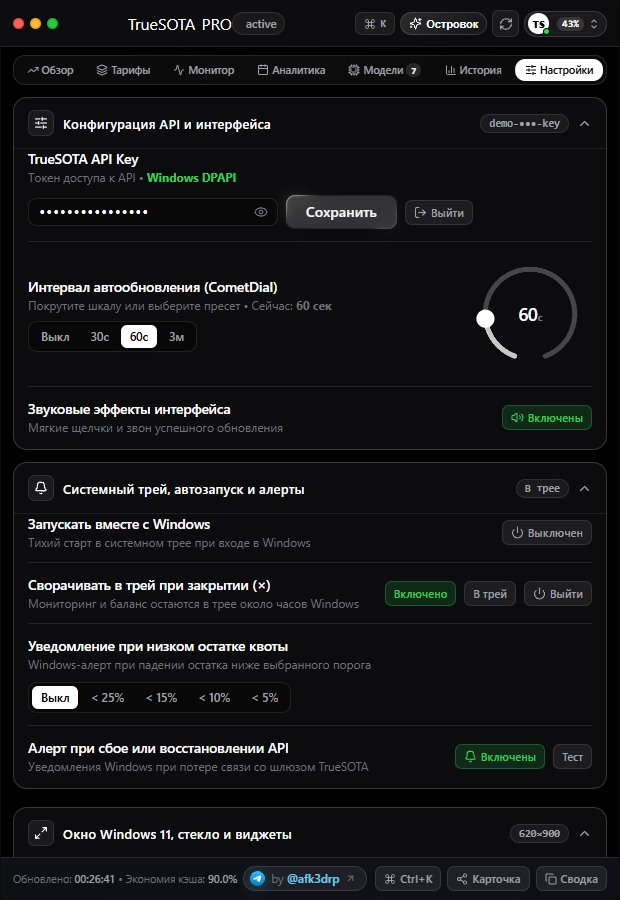
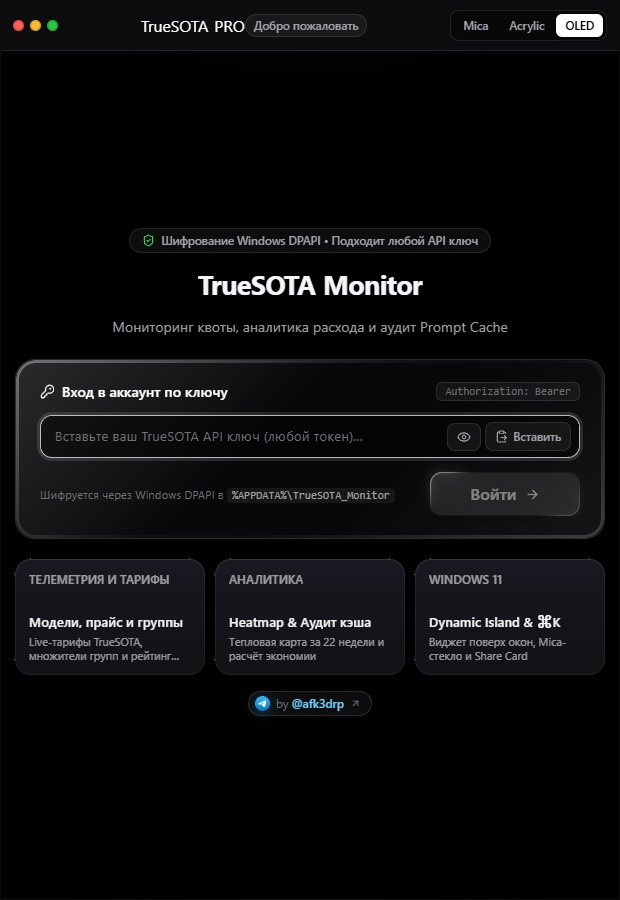
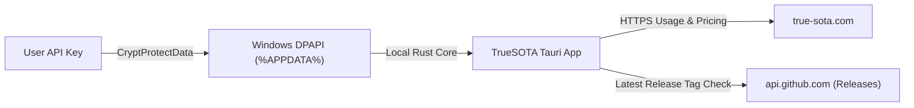

<div align="center">

<p>
  <a href="README.md">🇷🇺 Русский</a> &nbsp;·&nbsp; <b>🇬🇧 English</b>
</p>

<h1>TrueSOTA Usage Monitor</h1>

<p>
  <strong>Native OLED Desktop Client for Windows 11</strong> — monitor API quota balance, model pricing, Prompt Cache savings, and TrueSOTA gateway health straight from your desktop tray.
</p>

<p>
  <a href="https://github.com/afk3drp-dev/truesota-monitor/releases/latest">
    
  </a>
  <a href="https://github.com/afk3drp-dev/truesota-monitor/releases">
    
  </a>
  <a href="https://github.com/afk3drp-dev/truesota-monitor/actions/workflows/ci.yml">
    
  </a>
  <a href="LICENSE">
    
  </a>
  
  
  
</p>

<p>
  <a href="https://github.com/afk3drp-dev/truesota-monitor/releases/latest">
    
  </a>
  &nbsp;
  <a href="https://afk3drp-dev.github.io/truesota-monitor/">
    
  </a>
  &nbsp;
  <a href="https://t.me/afk3drp">
    
  </a>
</p>

<br />



</div>

<br />

> **Zero built-in keys or telemetry:** On first launch, each user enters their own personal API key. The token is encrypted locally using native **Windows DPAPI** (`CryptProtectData`) and stored only inside `%APPDATA%\TrueSOTA_Monitor\truesota_config.json`.

---

## Features

| Monitoring & Analytics | Interface & Ergonomics | System & Privacy |
| :--- | :--- | :--- |
| **Live Quota & Spend** — balance ring, limit, RPM/TPM telemetry, and 14-day trend bar chart | **Pure OLED Design** — true `#000000` black canvas, high-contrast typography, and `SmoothTab` motion | **Windows DPAPI Encryption** — token bound strictly to your Windows user profile |
| **Prompt Cache Audit** — cached token ratio and real dollar savings per model | **Portrait `620×900` + `1920×1080`** — compact card by default with instant window presets | **System Tray & Autostart** — minimize to tray on close (`×`) and launch silently with Windows |
| **22-Week Activity Heatmap** — daily usage blocks toggleable across `Cost $` / `Tokens` / `Requests` | **`Ctrl+K` Command Palette** — fuzzy jump across models, tabs, backdrop presets, and window sizes | **Native Windows Alerts** — notifications for low quota thresholds and gateway outages |
| **Live Model Pricing & Monitor** — rates per 1M tokens, group multipliers, and embedded gateway status | **Dynamic Island + Share Card** — floating mini-widget (`Alt+I`) and 16:9 PNG / CSV / Markdown export | **Release Checker** — lightweight update check directly via `GitHub Releases` |

---

## Download (`v1.2.0`)

Grab the prebuilt Windows x64 binaries from [**GitHub Releases**](https://github.com/afk3drp-dev/truesota-monitor/releases/latest) or test the UI in the [**Live Interactive Web Demo**](https://afk3drp-dev.github.io/truesota-monitor/):

| Artifact | Format | Best For |
| :--- | :--- | :--- |
| [**`TrueSOTA_Monitor_Installers.zip`**](https://github.com/afk3drp-dev/truesota-monitor/releases/download/v1.2.0/TrueSOTA_Monitor_Installers.zip) | Archive (`NSIS` + `MSI` + `README.md`) | **Recommended:** includes standard `TrueSOTA_Installer.exe` and `TrueSOTA_Setup.msi` |
| [**`TrueSOTA_Monitor_Tauri.exe`**](https://github.com/afk3drp-dev/truesota-monitor/releases/download/v1.2.0/TrueSOTA_Monitor_Tauri.exe) | Portable single `.exe` | Instant run with zero installation |

<details>
<summary><b>SHA-256 Checksums & Integrity Verification</b></summary>

<br />

| File (`v1.2.0`) | SHA-256 |
| :--- | :--- |
| `TrueSOTA_Monitor_Installers.zip` | `E2BFB91CB5DA6F9D4DBC129EC5661A8F5006326C75F70DA31B7B44D9988FBA8D` |
| `TrueSOTA_Monitor_Tauri.exe` | `30EA9442215A87E080FE3A2A6B09F7B75E92F91A7A57F99E994B9DF3D8C9AF74` |

```powershell
Get-FileHash .\TrueSOTA_Monitor_Installers.zip -Algorithm SHA256
Get-FileHash .\TrueSOTA_Monitor_Tauri.exe -Algorithm SHA256
```

See [SECURITY.md](SECURITY.md) for architecture details and [CHANGELOG.md](CHANGELOG.md) for version history.

</details>

<details>
<summary><b>Windows SmartScreen Note</b></summary>

<br />

This open-source build is not signed with a paid commercial EV code-signing certificate, so Windows SmartScreen may show an *"Unknown publisher"* prompt on first run.  
Click **More info → Run anyway** (and feel free to verify the SHA-256 hash or compile locally from source below).

</details>

---

## Interface Gallery

<details>
<summary><b>Expand all 7 app views</b></summary>

<br />

| Quota Overview (`620×900`) | Profile Dropdown | Command Palette (`Ctrl+K`) |
| :---: | :---: | :---: |
|  |  |  |

| Pricing & Multipliers | 22-Week Heatmap & Cache Audit | Settings & Tray | DPAPI Sign-In Screen |
| :---: | :---: | :---: | :---: |
|  |  |  |  |

</details>

---

## Keyboard Shortcuts & Window Modes

<details>
<summary><b>Quick shortcut reference</b></summary>

<br />

| Action | Shortcut / Location |
| :--- | :--- |
| Open Command Palette | `Ctrl + K` |
| Toggle Floating **Dynamic Island** | `Alt + I` or **Island** button |
| Switch Window Size (`620×900`, `880×880`, `1600×940`, Fullscreen) | `Ctrl + K` → Window Size / Settings |
| Copy Model ID to Clipboard | Click any row in **Pricing** or **Models** |

</details>

---

## Privacy & Architecture



- Network traffic goes strictly to [`https://true-sota.com`](https://true-sota.com) and GitHub's public latest-release endpoint (`afk3drp-dev/truesota-monitor/releases/latest`).
- Hardened Tauri WebView CSP, scoped capabilities, and CSV formula-injection guards on export.

---

## Build from Source

<details>
<summary><b>Build locally on Windows (Node.js 20+ · Rust MSVC · WebView2)</b></summary>

<br />

```powershell
git clone https://github.com/afk3drp-dev/truesota-monitor.git
cd truesota-monitor
npm install
npm run build
npm run tauri build
```

Binaries and installers are output to `src-tauri/target/release/` and `src-tauri/target/release/bundle/`.

</details>

---

<div align="center">
  <sub>Built with ❤️ by <a href="https://t.me/afk3drp">@afk3drp</a> · MIT Licensed · Tauri v2, React 19 & Rust</sub>
</div>
