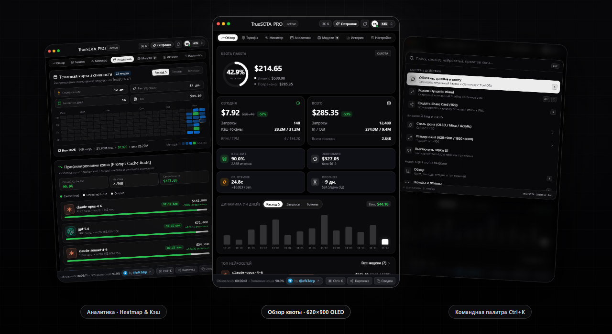
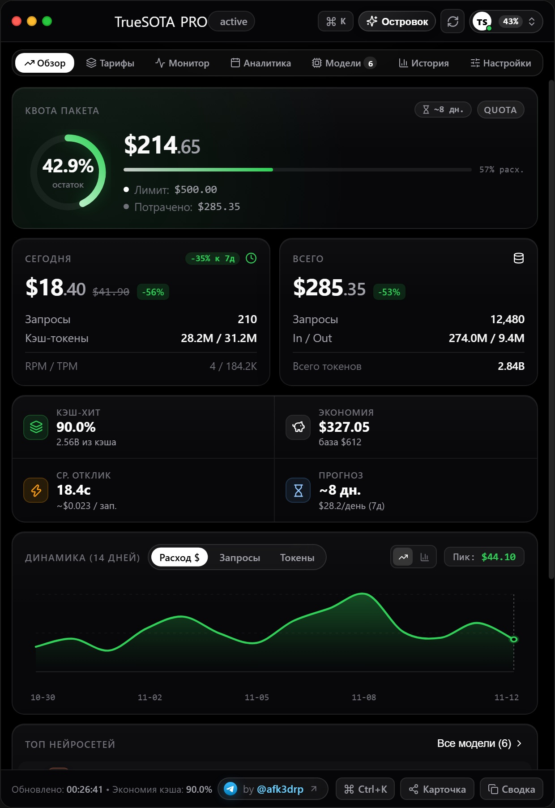
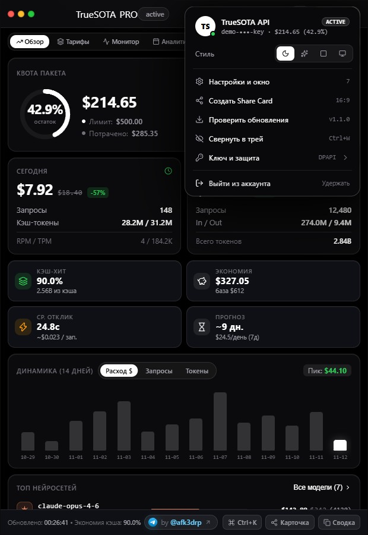
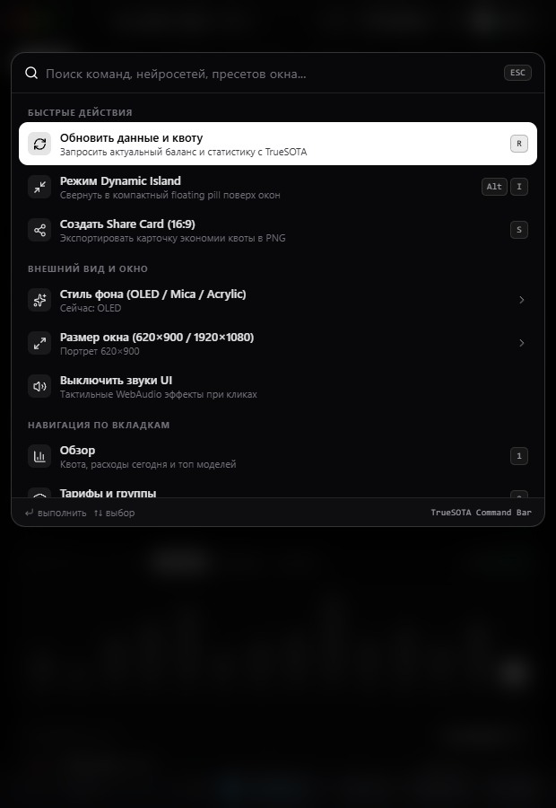
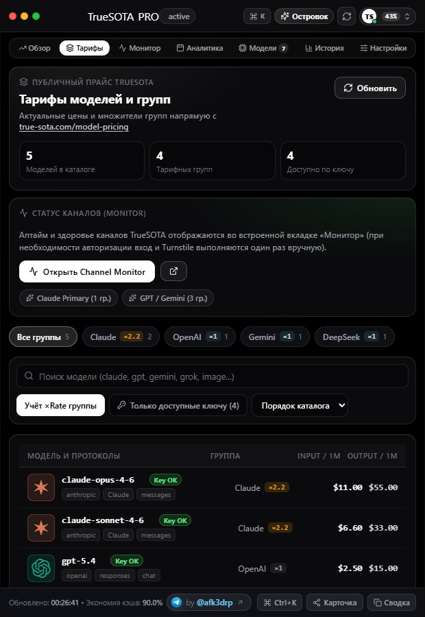
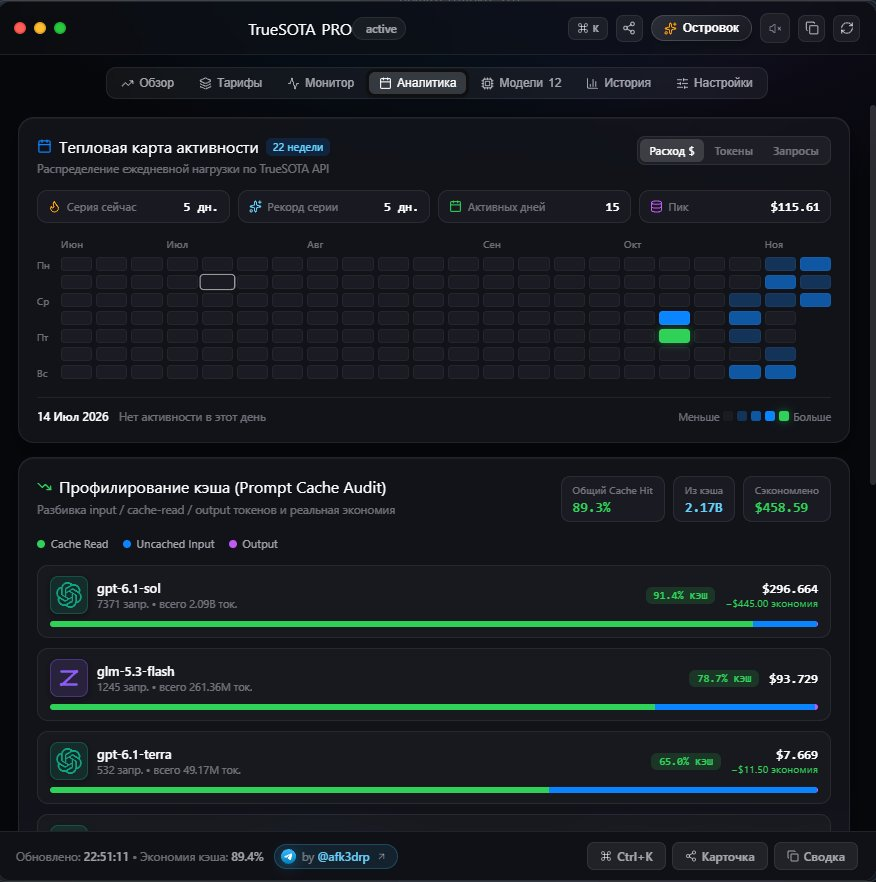
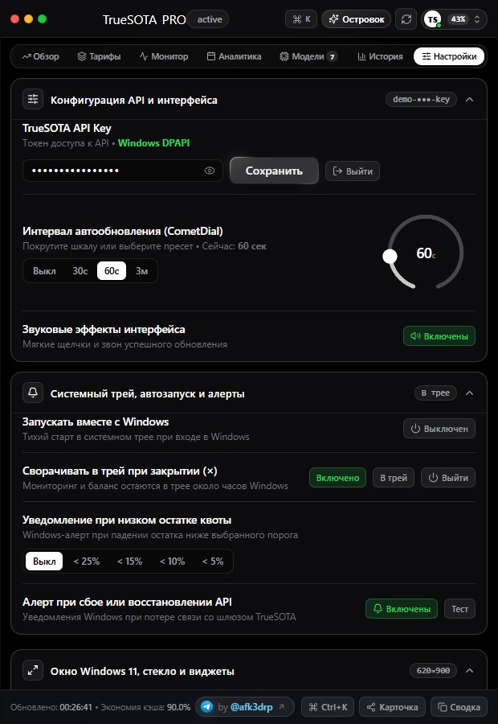
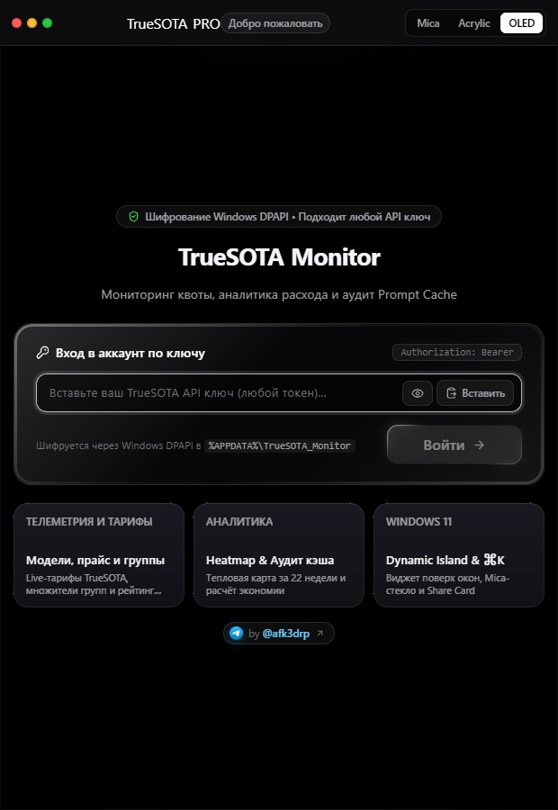
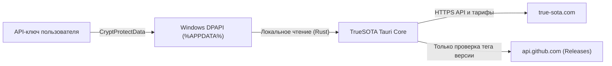

<div align="center">

<p>
  <b>🇷🇺 Русский</b> &nbsp;·&nbsp; <a href="README.en.md">🇬🇧 English</a>
</p>

<h1>TrueSOTA Usage Monitor</h1>

<p>
  <strong>Настольный OLED-клиент для Windows 11</strong> — баланс, квоты, тарифы моделей, аудит Prompt Cache и статус шлюза TrueSOTA прямо с рабочего стола.
</p>

<p>
  <a href="https://github.com/afk3drp-dev/truesota-monitor/releases/latest">
    
  </a>
  <a href="https://github.com/afk3drp-dev/truesota-monitor/releases">
    
  </a>
  <a href="https://github.com/afk3drp-dev/truesota-monitor/actions/workflows/ci.yml">
    
  </a>
  <a href="LICENSE">
    
  </a>
  
  
  
</p>

<p>
  <a href="https://github.com/afk3drp-dev/truesota-monitor/releases/latest">
    
  </a>
  &nbsp;
  <a href="https://afk3drp-dev.github.io/truesota-monitor/">
    
  </a>
  &nbsp;
  <a href="https://t.me/afk3drp">
    
  </a>
</p>

<br />



</div>

<br />

> **Без встроенных ключей и телеметрии:** при первом запуске каждый пользователь вводит свой личный API-ключ. Токен шифруется через встроенный **Windows DPAPI** и хранится только локально в `%APPDATA%\TrueSOTA_Monitor\truesota_config.json`.

---

## Возможности

| Мониторинг и Аналитика | Интерфейс и Удобство | Система и Приватность |
| :--- | :--- | :--- |
| **Квота и расход в реальном времени** — баланс, лимит, RPM/TPM и динамика за 14 дней | **Pure OLED тема** — чистый чёрный фон, высокий белый контраст и анимации `SmoothTab` | **Шифрование Windows DPAPI** — ключ привязан к вашей учётной записи Windows |
| **Аудит Prompt Cache** — сколько токенов взято из кэша и сколько денег сэкономлено | **Портрет `620×900` + `1920×1080`** — компактная карточка по умолчанию и пресеты окна | **Системный трей и автозапуск** — сворачивание по `×` к часам и тихий старт с Windows |
| **Тепловая карта (22 недели)** — активность по дням в режимах `Расход $` / `Токены` / `Запросы` | **Командная палитра `Ctrl+K`** — мгновенный поиск нейросетей, вкладок и переключение режимов | **Windows-уведомления** — алерты при низком остатке квоты и сбое/восстановлении API |
| **Каталог тарифов и монитор** — цены, мультипликаторы групп и встроенный `true-sota.com/monitor` | **Dynamic Island + Share Card** — мини-виджет поверх окон и экспорт карточки в PNG / CSV / MD | **Автопроверка обновлений** — отслеживание новых релизов прямо из `GitHub Releases` |

---

## Что скачать

Скачайте файлы со страницы [**Releases (v1.2.0)**](https://github.com/afk3drp-dev/truesota-monitor/releases/latest) или с [официальной промо-страницы](https://afk3drp-dev.github.io/truesota-monitor/#download):

| Файл | Формат | Кому подойдёт |
| :--- | :--- | :--- |
| [**`TrueSOTA_Monitor_Installers.zip`**](https://github.com/afk3drp-dev/truesota-monitor/releases/download/v1.2.0/TrueSOTA_Monitor_Installers.zip) | Архив (`NSIS` + `MSI` + `README.md`) | Рекомендуемый пакет: содержит стандартный установщик `TrueSOTA_Installer.exe` и корпоративный `TrueSOTA_Setup.msi` |
| [**`TrueSOTA_Monitor_Tauri.exe`**](https://github.com/afk3drp-dev/truesota-monitor/releases/download/v1.2.0/TrueSOTA_Monitor_Tauri.exe) | Portable (один `.exe`) | Запуск сразу без установки (подойдёт для флешки или отдельной папки) |

<details>
<summary><b>Контрольные суммы SHA-256 и проверка целостности (PowerShell)</b></summary>

<br />

| Файл (`v1.2.0`) | SHA-256 |
| :--- | :--- |
| `TrueSOTA_Monitor_Installers.zip` | `E2BFB91CB5DA6F9D4DBC129EC5661A8F5006326C75F70DA31B7B44D9988FBA8D` |
| `TrueSOTA_Monitor_Tauri.exe` | `30EA9442215A87E080FE3A2A6B09F7B75E92F91A7A57F99E994B9DF3D8C9AF74` |

```powershell
Get-FileHash .\TrueSOTA_Monitor_Installers.zip -Algorithm SHA256
Get-FileHash .\TrueSOTA_Monitor_Tauri.exe -Algorithm SHA256
```

Подробнее о безопасности и отчётах об уязвимостях — в [SECURITY.md](SECURITY.md), а история изменений — в [CHANGELOG.md](CHANGELOG.md).

</details>

<details>
<summary><b>Подсказка про Windows SmartScreen</b></summary>

<br />

Программа не подписана платным EV-сертификатом, поэтому при первом запуске Windows SmartScreen может показать предупреждение о неизвестном издателе.  
Чтобы открыть приложение, нажмите **«Подробнее» → «Выполнить в любом случае»**.

</details>

---

## Галерея интерфейса

<details>
<summary><b>Открыть все экраны приложения (7 скриншотов)</b></summary>

<br />

| Обзор квоты (`620×900`) | Меню аккаунта (`ProfileDropdown`) | Командная палитра (`Ctrl+K`) |
| :---: | :---: | :---: |
|  |  |  |

| Тарифы и фильтры | Тепловая карта и Audit кэша | Настройки и трей | Экран входа (`DPAPI`) |
| :---: | :---: | :---: | :---: |
|  |  |  |  |

</details>

---

## Горячие клавиши и режимы окна

<details>
<summary><b>Шпаргалка по сочетаниям и пресетам размера</b></summary>

<br />

| Действие | Сочетание / Где |
| :--- | :--- |
| Открыть командную палитру | `Ctrl + K` |
| Переключить мини-виджет (**Dynamic Island**) | `Alt + I` или кнопка **«Островок»** |
| Выбрать размер окна (`620×900`, `880×880`, `1600×940`, Fullscreen) | `Ctrl + K` → **Размер окна** или вкладка **Настройки** |
| Скопировать ID модели в буфер | Клик по любой строке во вкладке **Тарифы** или **Модели** |

</details>

---

## Приватность и архитектура



- Сетевые запросы отправляются только на официальный шлюз [`https://true-sota.com`](https://true-sota.com) и на публичный endpoint релизов GitHub (`afk3drp-dev/truesota-monitor/releases/latest`).
- Включены строгая политика безопасности WebView (`CSP`), изоляция Tauri capabilities и защита экспорта отчетов (`CSV` formula injection guard & safe paths).

---

## Сборка из исходников

<details>
<summary><b>Команды для локальной сборки (Node.js 20+ · Rust MSVC · WebView2)</b></summary>

<br />

```powershell
npm install
npm run build
npm run tauri build
```

Готовый `.exe` и установщики появятся в `src-tauri/target/release/` и `src-tauri/target/release/bundle/`.

</details>

---

<div align="center">
  <sub>Сделано <a href="https://t.me/afk3drp">@afk3drp</a> · На базе Tauri v2, React 19 и Rust</sub>
</div>
